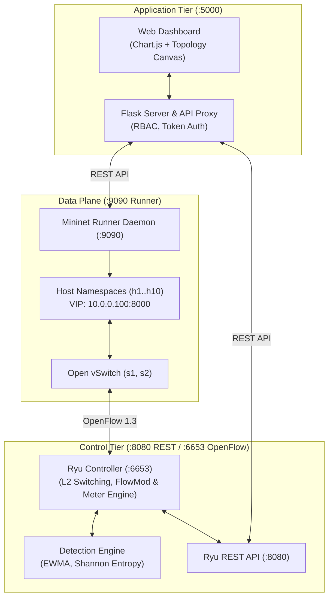

# SDN DDoS Mitigation & High-Availability Platform

[](https://opennetworking.org/wp-content/uploads/2014/10/openflow-spec-v1.3.0.pdf)
[](https://ryu-sdn.org/)
[](http://mininet.org/)
[](https://www.python.org/)
[](https://flask.palletsprojects.com/)
[](tests/)
[](LICENSE)

An SDN-based DDoS detection, mitigation, and high-availability (HA) framework built using the **Ryu SDN Controller** (OpenFlow 1.3) and **Mininet** network emulator.

The system monitors network traffic using statistical rate analysis (EWMA and Shannon entropy), dynamically injects OpenFlow drop/quarantine rules at the switch level, and coordinates an active/standby web service cluster with automatic Virtual IP (VIP) failover.

---

## Table of Contents

- [Features](#features)
- [System Architecture](#system-architecture)
- [Network Topology](#network-topology)
- [Prerequisites & System Requirements](#prerequisites--system-requirements)
- [Quick Start Guide](#quick-start-guide)
- [Web Dashboard & Access](#web-dashboard--access)
- [Attack Scenarios & Testing](#attack-scenarios--testing)
- [High Availability & Failover](#high-availability--failover)
- [Running Tests](#running-tests)
- [Repository Structure](#repository-structure)
- [Security Model](#security-model)
- [License](#license)

---

## Features

- **Rate-Based Anomaly Detection:** Real-time traffic tracking using Exponential Weighted Moving Average (EWMA), Shannon entropy, and threshold-based classification.
- **Dynamic OpenFlow Mitigation:** Installs switch drop flows (`priority=40000`, `cookie=0x424242`) on Open vSwitch to drop attack traffic at the ingress port while preserving benign traffic.
- **Traffic Quarantine:** Supports OpenFlow 1.3 Meter bands to rate-limit suspicious flows instead of dropping them outright.
- **High Availability (HA) Failover:** Active/standby HTTP cluster (`h2` / `h3`) sharing a Virtual IP (`10.0.0.100:8000`). Automatically migrates the VIP with Gratuitous ARP (`ip neigh replace`) if the primary node goes down.
- **Controller Failsafe Bypass:** Automatic bypass flow (`priority=87`, `actions=NORMAL`) prevents controller event starvation during high Packet-In surges.
- **Web Dashboard:** Single-page web interface with real-time Chart.js telemetry, interactive HTML5 topology canvas, and terminal console.

---

## System Architecture

The project consists of three main tiers:



---

## Network Topology

The default virtual network contains two interconnected OpenFlow switches running STP and 10 virtual hosts:

```
                  ┌────────────────────────┐
                  │  Ryu Controller (:6653)│
                  └───────────┬────────────┘
                              │ OpenFlow 1.3
              ┌───────────────┴───────────────┐
              ▼                               ▼
        ┌──────────────┐   Inter-Switch Trunk   ┌──────────────┐
        │  Switch s1   │◄─────────────────────►│  Switch s2   │
        └──────┬───────┘       (STP Enabled)   └──────┬───────┘
               │                                      │
     ┌─────────┼─────────┐                  ┌─────────┼─────────┐
     │         │         │                  │         │         │
     ▼         ▼         ▼                  ▼         ▼         ▼
   [h1]      [h2]      [h3]               [h4]      [h5]      [h6..h10]
  Client   HA Server HA Server           Client    Client    Client / Bots
            Primary   Standby
               │         │
               ▼         ▼
          Virtual IP (VIP): 10.0.0.100:8000
```

- **Service Cluster:**
  - `h2` (`10.0.0.2`): Primary HTTP server
  - `h3` (`10.0.0.3`): Standby HTTP server
  - `VIP` (`10.0.0.100:8000`): Shared Virtual IP bound to whichever node is active.
- **Client & Attack Nodes:** `h1`, `h4`, `h5`, `h6`, `h7`, `h8`, `h9`, `h10`.

---

## Prerequisites & System Requirements

| Requirement | Details | Notes |
|:---|:---|:---|
| **Operating System** | **Ubuntu Linux 22.04 LTS** or **20.04 LTS** (Bare-metal, VMware, or VirtualBox) | Mininet, Open vSwitch, and network namespaces (`ip netns`) require native Linux kernel modules and `veth` pair support. *(Windows/macOS can run unit tests and the web UI using mocks).* |
| **Privileges** | **Root / `sudo` access** | Required for creating OVS bridges, configuring network interfaces, and managing namespace routes. |
| **Internet Access** | Required during initial setup | Needed to download system packages via `apt` and Python packages via `pip`. |
| **Python** | Python 3.8, 3.10, or 3.12 | The installation script sets up a dedicated virtual environment at `.venv/`. |

---

## Quick Start Guide

Follow these 4 steps in an Ubuntu terminal to set up and run the platform:

### Step 1: Clone Repository & Make Scripts Executable
```bash
git clone https://github.com/<your-username>/sdn-ddos-mitigation-ha.git
cd sdn-ddos-mitigation-ha

chmod +x scripts/sdn_lab.sh scripts/lib/*.sh
```

### Step 2: Install Environment & Dependencies
```bash
./scripts/sdn_lab.sh install
```
This script automatically:
- Installs required system packages (`openvswitch-switch`, `mininet`, `glances`, `hping3`, `iperf3`, `tcpdump`, `curl`, `jq`).
- Creates a Python virtual environment in `.venv/`.
- Installs Ryu, Flask, and project dependencies.
- Sets up runtime directories (`.run/`, `logs/`, `pcap/`).

### Step 3: Run Test Suite (Sanity Check)
```bash
.venv/bin/python3 -m unittest discover -s tests
# Or:
.venv/bin/pytest -v
```
*(All 181 tests should pass: `OK`)*

### Step 4: Start Platform Services
```bash
./scripts/sdn_lab.sh start
```

This launches the 4 background services:

| Service | Port(s) | Protocol | Role |
|:---|:---:|:---:|:---|
| **Ryu Controller** | `6653` / `8080` | OpenFlow 1.3 / REST | Control plane, flow manager, and anomaly detection |
| **Mininet Runner** | `9090` | HTTP REST | Network topology emulation and attack generator |
| **Web Dashboard** | `5000` | HTTP | Flask web UI, real-time telemetry, and controls |
| **Glances** | `61208` | HTTP REST | CPU, RAM, and system resource monitoring |

### Operational Commands

| Command | Description |
|:---|:---|
| `./scripts/sdn_lab.sh status` | Check PID and status of all services |
| `./scripts/sdn_lab.sh logs` | View live aggregated logs from all components |
| `./scripts/sdn_lab.sh stop` | Stop all services and clean up Mininet interfaces |
| `./scripts/sdn_lab.sh restart` | Clean restart and topology reset |

---

## Web Dashboard & Access

The Flask web application listens on `0.0.0.0:5000`. You can access it from:

### 1. Local Access (Inside Ubuntu Desktop)
```text
http://localhost:5000/
```

### 2. Remote Access (From Host Machine / Windows Browser)
If Ubuntu is running in a VM (VMware or VirtualBox):
1. Find the VM's IP address in the Ubuntu terminal:
   ```bash
   hostname -I | awk '{print $1}'
   # Or: ip -br a
   ```
2. Open your Windows browser (Chrome, Edge, Firefox) and navigate to:
   ```text
   http://<UBUNTU_VM_IP>:5000/
   ```
   *(e.g., `http://192.168.1.50:5000/`)*.

### Default Accounts

| Role | Username | Password | Access Level |
|:---|:---:|:---:|:---|
| **Administrator** | `admin` | `admin123` | Full access: attack controls, mitigation toggles, HA failover, whitelist |
| **Standard Viewer** | `user` | `user123` | Read-only: telemetry charts, OpenFlow rules, audit logs |

> Passwords are stored in [`webapp/users.json`](webapp/users.json) as salted `PBKDF2-HMAC-SHA256` hashes. You can generate new password hashes using `python -m webapp.hash_password`.

---

## Attack Scenarios & Testing

### 1. Launching Attack Presets
From the **Attack Orchestration** panel in the Web UI (or via the REST API):
- **`dos_syn`**: Single-source TCP SYN flood (500 PPS)
- **`dos_udp`**: High-rate UDP flood (800 PPS)
- **`ddos_medium`**: Distributed SYN/UDP flood using 4 bots
- **`ddos_massive`**: Distributed flood using 6 bots
- **`port_scan`**: Rapid port scan across ports 1–1024

### 2. Observing Mitigation
When mitigation is enabled:
1. Within ~1.2s, the detection engine detects the rate violation.
2. Ryu installs drop flows in Open vSwitch:
   ```bash
   sudo ovs-ofctl -O OpenFlow13 dump-flows s1 "cookie=0x424242/-1"
   # Output: priority=40000,eth_type=0x0800,ipv4_src=10.0.0.7 actions=drop
   ```
3. Traffic from the attacking host is dropped at the switch ingress.

### 3. Verifying Benign Traffic
While an attack from `h7` is actively blocked, verify that legitimate clients can still reach the service:
```bash
sudo mininet/util/m h1 curl -s http://10.0.0.100:8000/
# Returns: HTTP 200 OK (< 3ms latency)
```

---

## High Availability & Failover

The platform monitors the active HTTP service on `10.0.0.100:8000`:
- **Health Checks:** Periodic probes check service reachability every second.
- **Automatic Failover:** If the primary node (`h2`) becomes unresponsive, Ryu signals failover to the backup node (`h3`).
- **Gratuitous ARP:** The backup node assumes the VIP (`10.0.0.100`) and broadcasts Gratuitous ARP updates to update switch MAC tables.
- **Failover Latency:** Service recovers in $<100\text{ms}$.

Manual failover can also be triggered from the Web UI or via the API:
```bash
curl -X POST -H "X-Internal-Token: $(cat .run/internal.token)" \
     http://127.0.0.1:9090/ha/toggle
```

---

## Running Tests

The test suite covers detection algorithms, flow management, HA failover, and security controls:

```bash
pytest -v
# Or:
python -m unittest discover -s tests
```

```text
======================= 181 passed in ~12s =======================
- test_attack_scenario_custom_attackers.py:   4 passed
- test_auth_fail_secure.py:                   8 passed
- test_cmd_console.py:                         9 passed
- test_common_utils.py:                        9 passed
- test_dos_guard_logic.py:                    11 passed
- test_f17_failover_coordination.py:          10 passed
- test_f18_unified_config_and_lifecycle.py:   10 passed
- test_f19_alerts_sync.py:                     8 passed
- test_f20_whitelist_persistence.py:         15 passed
- test_f30_log_and_pcap_lifecycle.py:         29 passed
- test_f30_ubuntu_live_integration.py:         5 passed
- test_job_stop_flow_cleanup.py:               4 passed
- test_manual_block_rejects_whitelisted_ip.py: 4 passed
- test_notes_verification.py:                  6 passed
- test_rbac_user_denial.py:                    5 passed
- test_ryu_detection_pure.py:                 14 passed
- test_security_and_api.py:                   25 passed
- test_whitelist_zero_trust.py:                5 passed
```

---

## Repository Structure

```text
sdn-ddos-mitigation-ha/
├── configs/                  # DNS fallback configurations
├── core/                     # Core utilities and configuration schema
│   ├── common_utils.py       # Type parsing, IP/MAC validators, file locking
│   └── sdn_config.py         # Unified configuration schema and environment loading
├── labs/                     # Mininet emulation & attack orchestration
│   ├── mininet_runner.py     # Port 9090 Flask runner daemon
│   ├── topology.py           # Dual-switch OpenFlow 1.3 topology manager
│   ├── attack_engine.py      # SYN/UDP flood traffic generator (hping3)
│   ├── ha_manager.py         # Active/Standby VIP migration and Gratuitous ARP
│   ├── pcap_manager.py       # Packet capture and storage rotation
│   └── cmd_console.py        # Diagnostic console (ping, iperf, ovs-ofctl)
├── ryu_app/                  # Ryu SDN Controller application
│   ├── dos_guard.py          # RyuApp controller entry point
│   ├── flow_manager.py       # OpenFlow 1.3 flow table management
│   ├── mitigation_manager.py # Drop flows, quarantine meters, and failsafe bypass
│   ├── monitor_engine.py     # Anomaly detection loop and HA failover
│   ├── traffic_tracker.py    # PacketIn accounting and rate calculations
│   ├── web_controller.py     # Ryu REST API WSGI layer (:8080)
│   └── detection.py          # Mathematical detection (EWMA, Shannon entropy)
├── scripts/                  # Operational scripts
│   ├── sdn_lab.sh            # Main CLI orchestrator (start, stop, status, logs)
│   ├── sdn_lab.logrotate     # Log rotation configuration
│   ├── harden_server_ubuntu22.sh # Optional: Server hardening script (nftables + Nginx)
│   └── lib/                  # Helper scripts (service, env, log, tunnel)
├── tests/                    # 18 test suites covering 181 unit & integration tests
├── webapp/                   # Web dashboard (Flask)
│   ├── server.py             # Flask application entry point (:5000)
│   ├── users.json            # PBKDF2 hashed user database
│   ├── blueprints/           # Flask routes (dashboard, monitoring, events, etc.)
│   ├── core/                 # Security middleware, session auth, alerts sync
│   └── static/               # Vanilla JS frontend (Chart.js, Canvas topology)
├── .gitignore                # Git ignore rules
└── requirements.txt          # Python dependencies
```

---

## Security Model

- **Authentication & Sessions:** Protected by CSRF tokens, `HttpOnly` / `SameSite=Lax` session cookies, and API rate limiting.
- **Inter-Service Communication:** Internal communication between the WebApp (:5000), Ryu (:8080), and Runner (:9090) requires a shared secret token (`X-Internal-Token`) verified using constant-time comparison (`hmac.compare_digest`).
- **Infrastructure Protection:** Infrastructure IPs (`10.0.0.1`–`10.0.0.3` and VIP `10.0.0.100`) cannot be blocked by drop rules, protecting management connectivity.

---

## License

This project is licensed under the MIT License — see the [LICENSE](LICENSE) file for details.
